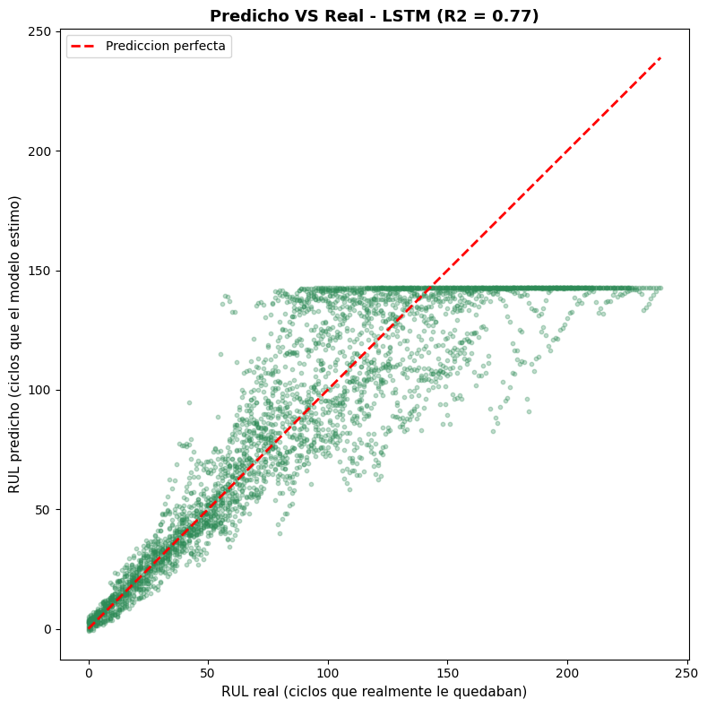
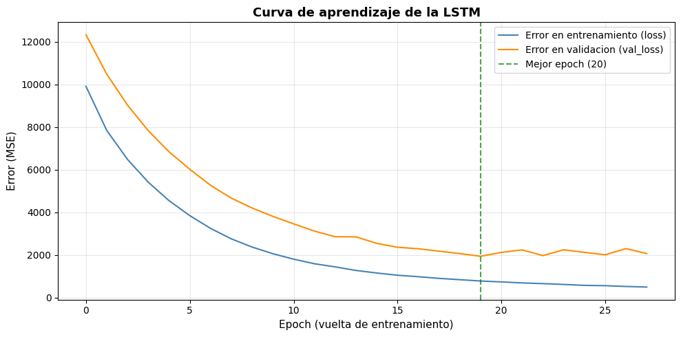

# 🔧 Mantenimiento Predictivo de Motores — Predicción de Vida Útil Restante (RUL)

Proyecto de Machine Learning que predice la **vida útil restante (RUL — Remaining Useful Life)** de motores de turbina a partir de datos de sensores, con el objetivo de anticipar fallas y programar el **mantenimiento preventivo** en el momento óptimo.

Dataset: **NASA C-MAPSS (Turbofan Engine Degradation Simulation)**.

---

## 🎯 El problema de negocio

Una máquina que se detiene por una falla inesperada genera costos enormes: parada de producción, reprogramación, horas extra, material desperdiciado y entregas tardías. El **mantenimiento predictivo** busca resolver esto: en lugar de reparar cuando algo ya se rompió (mantenimiento correctivo) o a intervalos fijos (preventivo tradicional), usa los datos de los sensores para **predecir cuándo va a fallar cada equipo** y actuar justo a tiempo.

**La pregunta que responde el modelo:** dado el estado actual de los sensores de un motor, ¿cuántos ciclos de vida le quedan antes de fallar?

---

## 📊 Los datos

El dataset C-MAPSS de la NASA simula la degradación de una flota de motores de turbina:

- **100 motores** (subset FD001), cada uno monitoreado ciclo a ciclo desde que está sano hasta que falla.
- **21 sensores** + 3 parámetros operativos por ciclo.
- Cada motor es una **serie temporal**: una secuencia de su degradación en el tiempo.
- La variable objetivo (**RUL**) no viene dada: se construye como `ciclo de falla − ciclo actual`.

> Los datos no se incluyen en este repositorio por ser de terceros. Se pueden descargar del repositorio oficial de la NASA (NASA Prognostics Center of Excellence — C-MAPSS Turbofan Engine Degradation Simulation Data Set).

---

## 🔬 Metodología

El proyecto recorre el flujo completo de un proyecto de Machine Learning:

1. **Exploración y limpieza (EDA):** análisis de la estructura temporal, de la vida útil de los motores (media ~206 ciclos, distribución asimétrica) y del comportamiento de cada sensor.
2. **Selección de features:** descarte de los 7 sensores planos (sin información) y de las variables operativas (constantes en FD001), conservando los 14 sensores con tendencia.
3. **Ingeniería de features:** construcción de la variable objetivo RUL.
4. **Modelado y comparación:** se probaron progresivamente varios algoritmos, de menor a mayor complejidad.
5. **Optimización:** ajuste de hiperparámetros (incluido Grid Search con validación cruzada).
6. **Evaluación e interpretación:** métricas, importancia de features y análisis visual de las predicciones.

---

## 🏆 Resultados

Comparación de los modelos sobre el conjunto de test (métricas de regresión):

| Modelo | R² | MAE (ciclos) | RMSE (ciclos) |
|---|---|---|---|
| Regresión Lineal | 0.6550 | 30.53 | 39.70 |
| Árbol de Decisión | 0.6851 | 27.66 | 37.93 |
| K-Vecinos (KNN) | 0.7105 | 26.00 | 36.37 |
| Random Forest (optimizado) | 0.7221 | 25.27 | 35.64 |
| **Red Neuronal LSTM** 🥇 | **0.7701** | **19.33** | **27.93** |

**El modelo final (LSTM) mejoró notablemente a los modelos clásicos**, reduciendo el error promedio de ~25 a ~19 ciclos. La clave fue aprovechar la **estructura temporal** de los datos: mientras los modelos clásicos miran cada ciclo de forma aislada, la LSTM procesa la secuencia completa de degradación (ventanas de 30 ciclos), capturando la tendencia que anticipa la falla.

Un hallazgo relevante: el modelo predice con **alta precisión los RUL bajos** (motores cerca de fallar — lo crítico para el negocio) y "satura" los RUL altos (motores sanos, donde la precisión exacta no aporta valor de decisión).

---

## 📈 Visualizaciones

| Predicho vs Real (LSTM) | Curva de aprendizaje (LSTM) |
|---|---|
|  |  |

---

## 🛠️ Tecnologías

- **Python 3**
- **pandas / numpy** — manipulación y procesamiento de datos
- **scikit-learn** — modelos clásicos, métricas, escalado, Grid Search
- **TensorFlow / Keras** — red neuronal LSTM
- **matplotlib** — visualizaciones
- Entorno: **Google Colab**

---

## 📁 Estructura del repositorio

```
mantenimiento-predictivo-nasa/
├── README.md
├── .gitignore
├── notebook/
│   └── NASA.ipynb                  # desarrollo completo del proyecto
└── imagenes/
    ├── predicho_real_LSTM.png
    └── curva_aprendizaje_LSTM.png
```

---

## 🚀 Posibles mejoras a futuro

- Probar los subsets más complejos (FD002–FD004, con múltiples condiciones de operación).
- Implementar el modelo como una API (deploy) que reciba sensores y devuelva el RUL en tiempo real.
- Explorar arquitecturas más avanzadas (LSTM apiladas, atención).

---

## 👤 Autor

**Mauro** — [@FMauro17](https://github.com/FMauro17)

> Proyecto desarrollado como parte de mi formación en Machine Learning y Ciencia de Datos.
